# Hub personal para tablet

Una aplicación web instalable (PWA) que convierte una tablet Android en un panel personal: agenda y tareas, correo, búsqueda de empleo, un árbol de habilidades, música y rutinas. Pensada para una Samsung Galaxy Tab S10 FE, con interfaz táctil y seis temas visuales.

> **Todas las capturas usan datos ficticios.** Se hicieron con una copia limpia del proyecto en modo de ejemplo: ningún correo, evento, tarea, postulación, cuenta ni canción es real.

**Código:** [mrodriguezf24/hub_tablet](https://github.com/mrodriguezf24/hub_tablet)

## Qué incluye

| Página | Qué hace |
|---|---|
| **Hoy / Semana** | Reloj en siete segmentos, clima, agenda y pendientes del día, y la vista de la semana. Se conecta a Google Calendar y Google Tasks. |
| **Correo** | Bandeja de varias cuentas (Gmail, Outlook) en solo lectura: el hub no puede enviar, borrar ni marcar nada. |
| **Radar** | Búsquedas de empleo por perfil con un enlace por portal y filtro de antigüedad, ofertas remotas de fuentes abiertas, noticias del sector por RSS y control de postulaciones. |
| **Habilidades** | Árbol de habilidades en un dial radial: cursos, libros y prácticas con porcentajes de avance y prerrequisitos. |
| **Música** | Lo que suena en Spotify con controles; también aparece como tarjeta en el modo ambiente. |
| **Rutinas** | Tareas que se repiten (cada N días, por usos o cada año) con una barra de ciclo y su ritmo real. |
| **Finanzas** | Presupuestos y movimientos, protegidos con PIN en el backend (no se muestra aquí). |

## Capturas

### Navegación y vistas del día
Un selector único abre un menú circular con todas las páginas; las flechas recorren las páginas en ciclo.

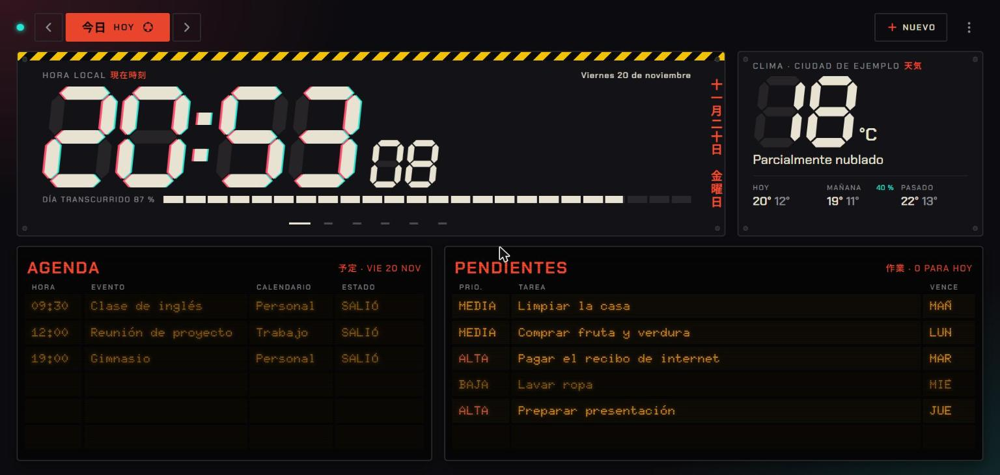
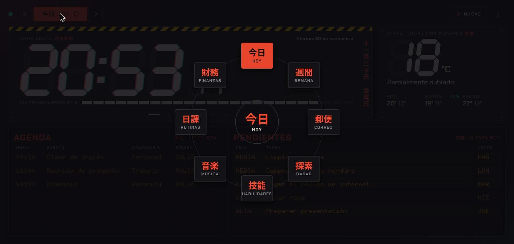
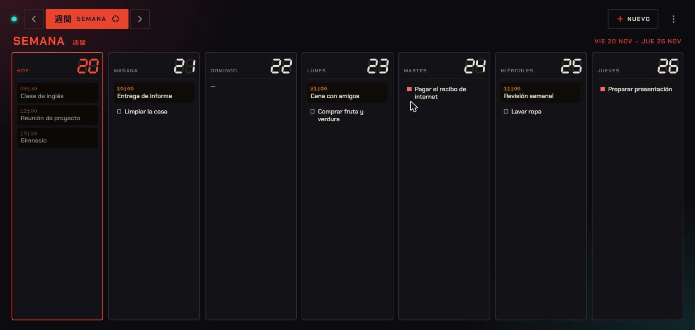

### Radar: empleo y noticias
Los portales de empleo no ofrecen datos abiertos, así que el hub genera, para cada búsqueda, un enlace por portal ya filtrado (México y la antigüedad elegida). Las ofertas remotas y las noticias sí se leen de fuentes abiertas y se clasifican por tema.

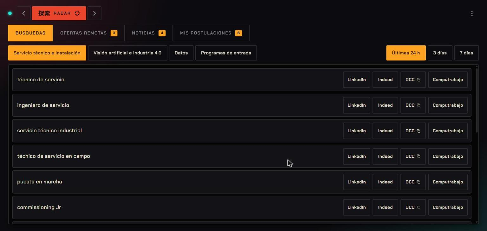
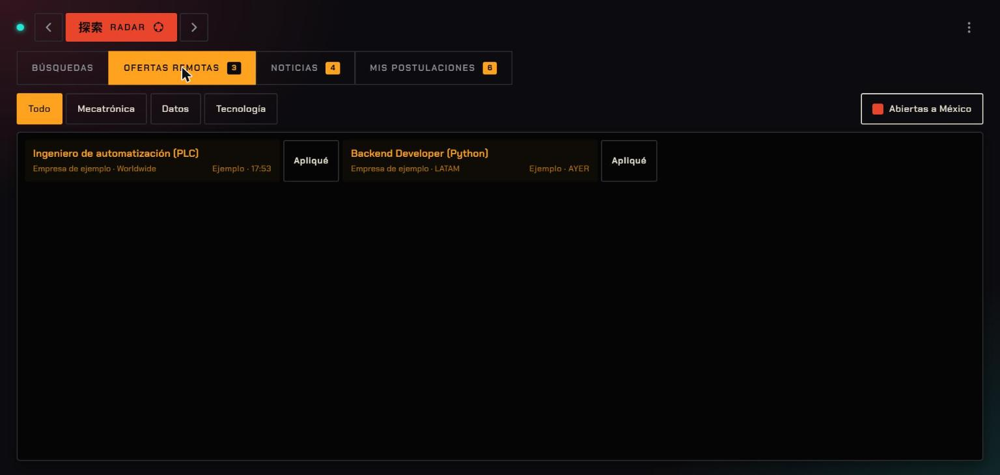
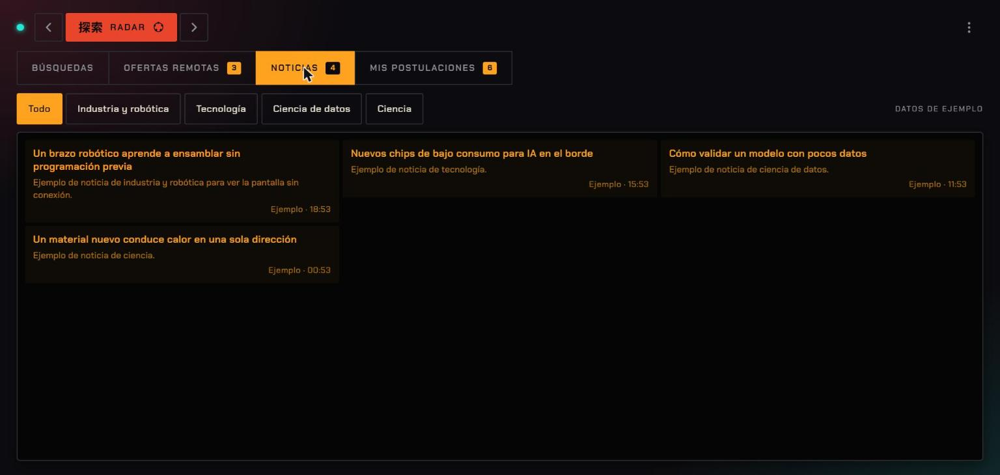
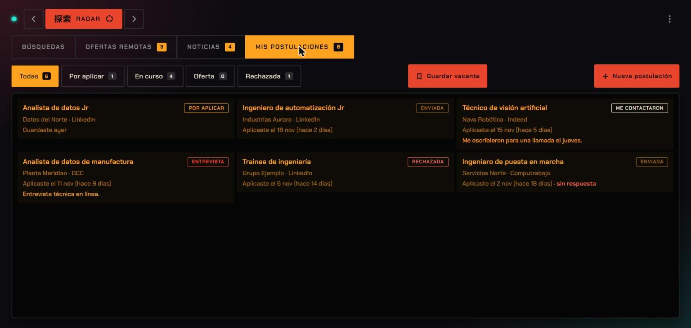

### Habilidades: un árbol de habilidades
Cada rama es un sector del dial y la distancia al centro es el nivel. Los estados se distinguen por forma, no solo por color: bloqueada (punteada), disponible (vacía), en curso (anillo con su porcentaje) y dominada (rellena). Cada rama traza sus nodos y líneas a su manera: hexágonos y pistas de circuito, círculos con visor, barras que se llenan y pastillas.

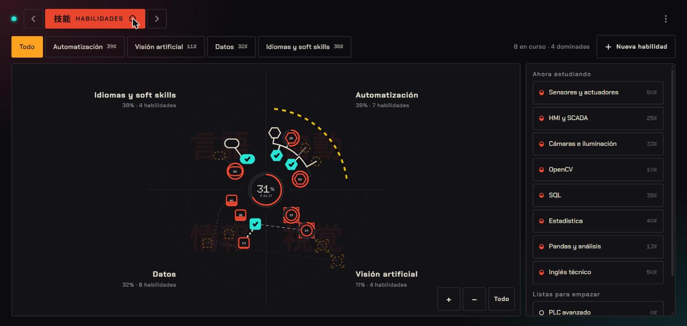
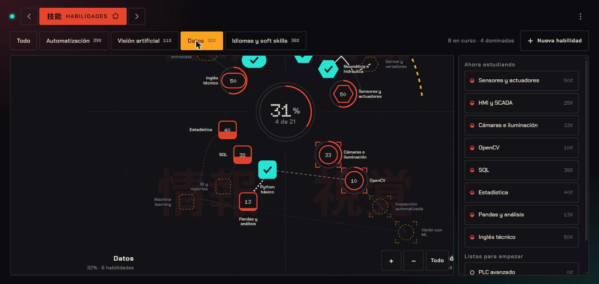
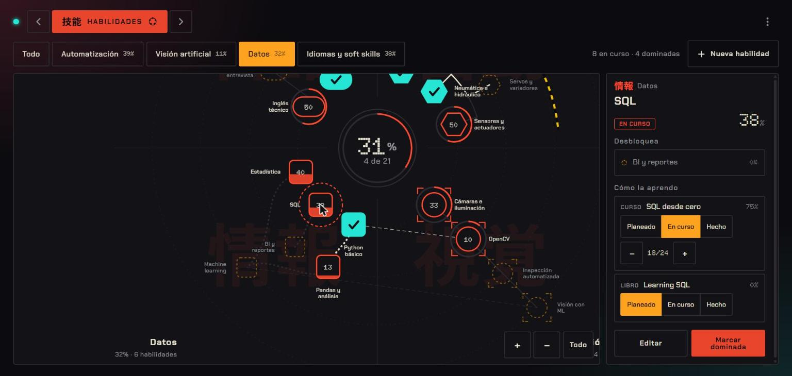

### Música y rutinas
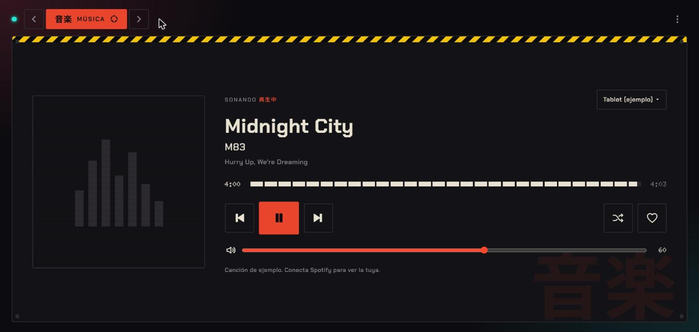
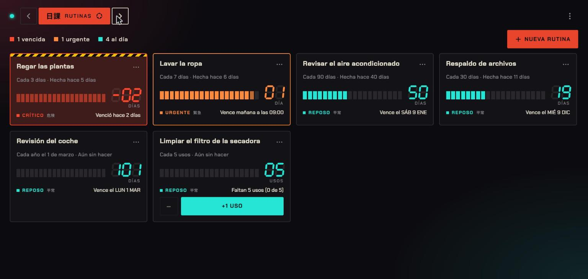
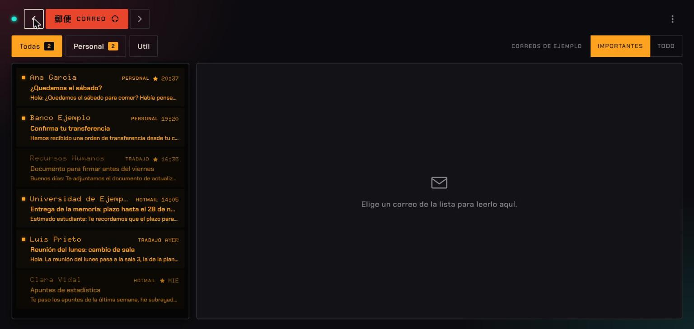

### Temas y modo ambiente
Seis temas hechos solo con variables CSS. El tema monocromo (e-ink) conserva la información porque los estados dependen de la forma. Tras unos minutos sin tocar la pantalla aparece un modo ambiente, tenue y sin elementos que parpadeen.

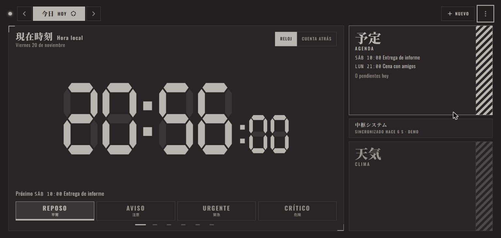
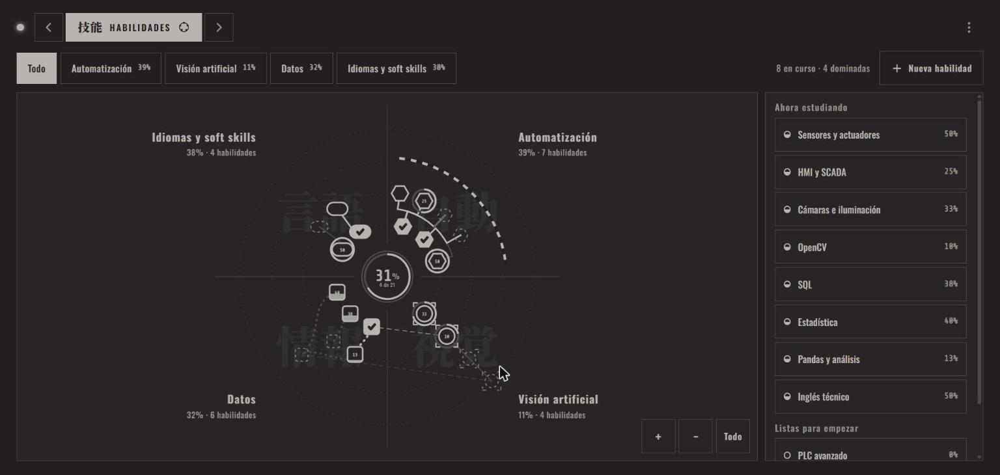
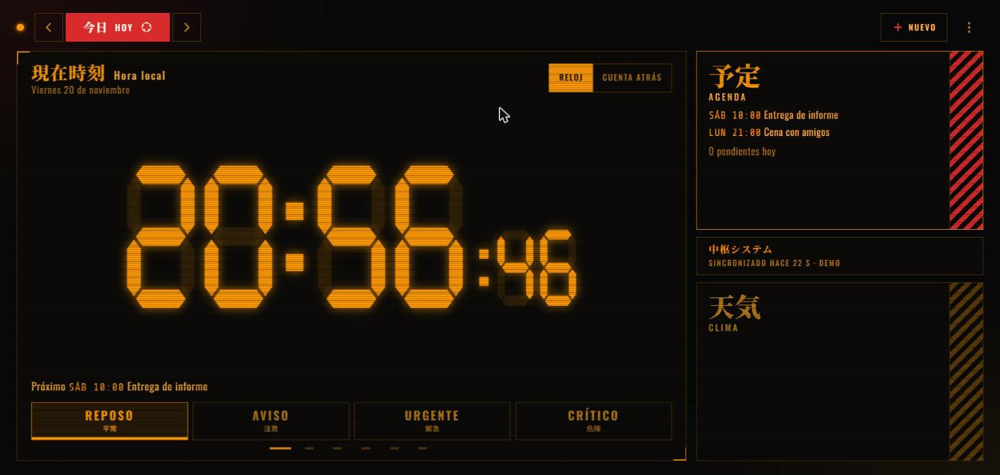
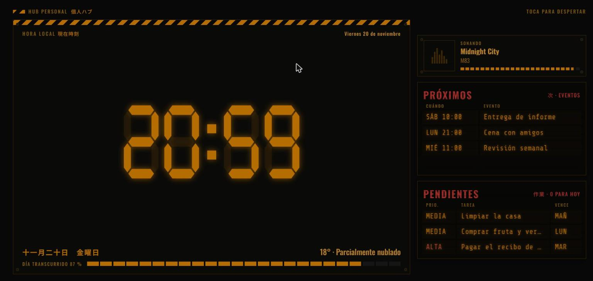

## Decisiones técnicas

- **Backend modular.** Cada página es un módulo (`modules/<nombre>/`) con su `config.yaml`, su `router.py` y su carpeta de datos. El backend los descubre y los registra solo.
- **Validación en el servidor.** Los datos que escribe el usuario (postulaciones, habilidades, rutinas) pasan por modelos de Pydantic; las habilidades, por ejemplo, rechazan prerrequisitos circulares.
- **Datos propios fuera de Git.** Todo lo que genera el usuario vive en `data/` (ignorado por Git), se escribe de forma atómica y nunca se sobrescribe un archivo que no se pueda leer.
- **Privacidad por diseño.** El correo es de solo lectura, no guarda su contenido y se oculta al pasar al modo ambiente; la tablet nunca habla con Spotify directamente.
- **Fuentes abiertas, sin scraping.** Las ofertas remotas salen de APIs y RSS públicos; los portales cerrados se enlazan con filtros en lugar de extraer sus datos.
- **Pequeñas piezas de análisis.** Clasificación de ofertas por tema a partir del título, y un ritmo real de las rutinas calculado con la mediana de las últimas veces para que una racha rara no lo distorsione.

## Tecnologías

Python · FastAPI · Pydantic · React 19 · Vite · PWA · CSS con variables de tema · Spotify Web API · Google Calendar/Tasks/Gmail API · Microsoft Graph

## Cómo verlo en modo de ejemplo

```bash
git clone https://github.com/mrodriguezf24/hub_tablet
cd hub_tablet
python -m venv .venv
.venv\Scripts\activate          # Windows
pip install -r requirements.txt
cd frontend && npm install && npm run build && cd ..
python -m uvicorn backend.app.main:app
```

Abre http://localhost:8000. Sin configurar nada se ven datos de ejemplo; el README de cada módulo explica cómo conectar tus propias cuentas.
